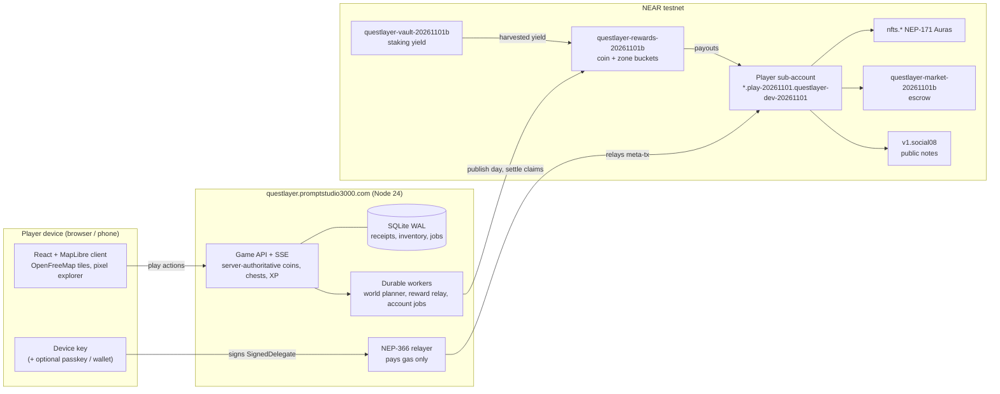

# QuestLayer

**Little adventures. Real discoveries.** A location-based exploration game on real OpenStreetMap geography,
built on NEAR. Walk through Plzeň, collect street coins, open a zone chest, receive an Aura and wear it on your
character. The NEAR account, the rewards and the Aura NFTs exist, but the player never sees a wallet popup,
a seed phrase or a gas prompt: the chain is a property of the items, not a screen.

Built for the [NEAR Hackathon](https://nearhackathon.com/) (1–14 November 2026), tracks **Games With Real
Economies** and **Open Innovation**. Everything runs on NEAR **testnet**; nothing here has monetary value.

**Timeline, stated per the rules.** The hackathon window runs from the announcement on 19 October 2026 to
14 November 2026 (HACKATHON.md, Q-001). Every commit in this repository was made inside that window: the first
commit is dated 31 October 2026 and the alpha, the testnet pilots and all later work were built in the window. There
is no pre-hackathon baseline to separate (Q-003); development continues on the branch `claude/upbeat-gauss-5czir7`
and merges into `main`. Commit dates are real and were not rewritten.

## For judges: 60 seconds, no install

Open **https://questlayer.promptstudio3000.com/** on a phone or desktop. No wallet, no extension, no seed phrase.

| # | Do | See |
| --- | --- | --- |
| 1 | Type a name under "What should we call you?", press **Start exploring** | The Plzeň map with your ghost explorer in the city centre. You are in the city demo: tapping the map moves you. |
| 2 | Tap the map next to a gold coin on a path | The coin disappears for every player, the counter ticks and you get XP. |
| 3 | Press the **Nearest discovery** card, then **Walk there** (repeat until in range), then **Open chest** | The result sheet: exact XP and the Aura you received ("Reward collected"). |
| 4 | Press **Try it on** | The same Aura is now worn by your character on the map. |
| 5 | Press **Secure this Aura**, then **Share your Aura** | The Aura is minted as an NFT to your own NEAR account in the background (no popup, gas is sponsored); sharing opens the share sheet with a PNG card (downloads on desktop). |
| 6 | Reload the page | Name, XP, Aura and equipment are still there. |
| 7 | Profile → **Advanced** | Your NEAR account id and the network. This is the only place the chain is named. |

On a phone outside Plzeň, **Use my location** switches to your own surroundings (street finds on mapped paths
near you); the six daily zones with chests exist in Plzeň.

## What is on chain, and where to see it

Every account below is on NEAR **testnet**, existed on 1 November 2026 (checked with `view_account` against
`rpc.testnet.near.org`) and matches the manifests in `public/native-*-testnet.json` and
`public/testnet-deployment.json`. Click an id to open it on NearBlocks.

| Piece | Account (explorer link) | What to look for |
| --- | --- | --- |
| Player account factory (parent of every explorer) | [`play-20261101.questlayer-dev-20261101.testnet`](https://testnet.nearblocks.io/address/play-20261101.questlayer-dev-20261101.testnet) | Your explorer is `<name-slug>.play-20261101.questlayer-dev-20261101.testnet`, shown in Profile → Advanced. Created after step 1, key held only by your device ([docs/RELAYER.md](docs/RELAYER.md)). |
| Auras and avatars, NEP-171 ([contracts/collectibles](contracts/collectibles)) | [`nfts.questlayer-dev-20261101.testnet`](https://testnet.nearblocks.io/address/nfts.questlayer-dev-20261101.testnet) | The mint from step 5 to your account, and equip calls. |
| Game contract ([contracts/game](contracts/game)) | [`game.questlayer-dev-20261101.testnet`](https://testnet.nearblocks.io/address/game.questlayer-dev-20261101.testnet) | Coin/zone buckets and claim batches (`public/testnet-deployment.json`). |
| Gas sponsor, NEP-366 relayer | [`relay-20261101.questlayer-dev-20261101.testnet`](https://testnet.nearblocks.io/address/relay-20261101.questlayer-dev-20261101.testnet) | Meta-transactions relayed for players. It never carries money. |
| Rewards treasury: coins, zone prizes, XP ([contracts/rewards](contracts/rewards)) | [`questlayer-rewards-20261101b.testnet`](https://testnet.nearblocks.io/address/questlayer-rewards-20261101b.testnet) | Published days and claims. Live books check: `/api/native/distribution` returns `status: verified`. |
| Vault factory ([contracts/vault-factory](contracts/vault-factory)) | [`questlayer-vaults-20261101b.testnet`](https://testnet.nearblocks.io/address/questlayer-vaults-20261101b.testnet) | Created the staking vault below. |
| Staking vault that funds rewards from yield ([contracts/vault](contracts/vault)) | [`questlayer-vault-20261101b.testnet`](https://testnet.nearblocks.io/address/questlayer-vault-20261101b.testnet) | Harvests into the treasury; timeline in `public/native-yield-cycle.json`. |
| Aura market, fixed-price escrow ([contracts/market](contracts/market)) | [`questlayer-market-20261101b.testnet`](https://testnet.nearblocks.io/address/questlayer-market-20261101b.testnet) | Profile → Market: list, buy, cancel. |
| Creator money: paid quests, donations ([contracts/creators](contracts/creators)) | [`questlayer-creators-20261101b.testnet`](https://testnet.nearblocks.io/address/questlayer-creators-20261101b.testnet) | Pilot, enabled on the public host. |
| Sponsored tasks escrow ([contracts/tasks](contracts/tasks)) | [`questlayer-tasks-20261031.testnet`](https://testnet.nearblocks.io/address/questlayer-tasks-20261031.testnet) | Pilot, earlier generation. |
| Public map notes (NEAR Social, not ours) | [`v1.social08.testnet`](https://testnet.nearblocks.io/address/v1.social08.testnet) | Notes written under the player's own namespace. |
| Operator (deploys and owns the dev contracts) | [`questlayer-dev-20261101.testnet`](https://testnet.nearblocks.io/address/questlayer-dev-20261101.testnet) | Plain account, no contract code. |

[`GET /api/health`](https://questlayer.promptstudio3000.com/api/health) shows `"network":"testnet"`, the enabled features
(collectibles, market, rewards, vaults, relayer, social, creators, tasks), the relayer account, the creator-money
contract and `distribution.status: verified`. The 3-minute demo script is [docs/HACKATHON-DEMO.md](docs/HACKATHON-DEMO.md). Transaction proofs with hashes (no keys) are in `public/`; some were recorded on earlier testnet
generations (`questlayer-dev-20261031`, `auratrail-dev-20261030`), so their account names differ from the table:

- `native-invisible-account-proof.json`: name → sponsored sub-account → relayed avatar mint, no wallet.
- `earned-aura-testnet.json`: a chest Aura earned in play and secured to the player's own account.
- `native-distribution-proof.json`: the treasury audit behind "Books checked".
- `native-creators-proof.json`: paid quest access 80/20, donation, support round, creator withdrawal.
- `native-public-record-proof.json`: a public map note under the player's own NEAR Social namespace.
- `native-sponsored-stake-proof.json`: the stake is paid by the player's key; the relayer refuses money.
- `native-rewards-testnet.json`, `native-market-testnet.json`, `native-claims-testnet.json`: contract manifests
  with code hashes.

## Testnet now, mainnet honestly

Everything runs on **testnet** today and nothing here has monetary value. GOLD on the map is practice GOLD unless
the server publishes a funded day (then **Today's pot** shows the amounts and their source). Mainnet is a
deliberate, gated step: [docs/MAINNET-PLAN.md](docs/MAINNET-PLAN.md) defines a minimal slice (collectibles,
sponsored accounts and gas with daily caps, NEAR Social) behind `NEAR_NETWORK=mainnet` and `MAINNET_FEATURES`,
with a go/no-go gate on 9 November 2026. The rewards treasury, vaults, market and creator money stay on testnet
until they have an external review. If mainnet ships, this section will name the accounts; until then, any claim
of "mainnet" elsewhere is wrong.

## Run it yourself

Requirements: Node.js 24 (`.nvmrc`), npm. No wallet, no keys.

```bash
npm ci
npm run dev        # open http://127.0.0.1:5173/
```

The steps above work the same locally (secure needs a relayer, see [docs/HOW-TO-TRY.md](docs/HOW-TO-TRY.md)).
Automated checks: `npm run check` (build, application tests, mainnet-guard tests) and
`bash scripts/build-contracts.sh --test` (contract tests). The full guide, including the isolated QA server,
the testnet scripts and phone testing, is [docs/HOW-TO-TRY.md](docs/HOW-TO-TRY.md).

Cities come from `server/data/cities.json`: Plzeň is the only live and funded city; a second city is a new
CityPack file plus one registry line ([docs/SECOND-CITY-PLAYBOOK.md](docs/SECOND-CITY-PLAYBOOK.md)).

## The economy, in one page

[docs/ECONOMY-RULES.md](docs/ECONOMY-RULES.md) lists every live number with its source: 1 NEAR = 1,000 GOLD
display units, coins worth 0.01 GOLD backed before publication, a 50/50 split of eligible income into coin and zone
buckets, six daily Plzeň zones with shared prizes that pay once, personal XP once per account, level rewards as
capped Auras. Practice-only numbers (the 120,000 GOLD welcome credit) are marked as such. Unclaimed backing
returns to its bucket; more players never create money.

## Architecture



The player's key signs; the relayer only pays gas; contracts enforce backing and exactly-once claims; the server is
trusted for location evidence only.

- **Client**: React 19 + TypeScript + Vite, MapLibre on OpenFreeMap vector tiles, Aavegotchi-compatible pixel
  character (official template layers, see `public/art/aavegotchi/provenance.json`).
- **Server**: Node 24 ESM, SQLite (WAL), server-authoritative gameplay (coins, quests, receipts, equipment),
  durable background workers (world planner, reward relay, account/relayer jobs) with leases and backoff.
- **Contracts**: Rust `near-sdk` workspace with eight members (game, collectibles, rewards, vault, vault-factory,
  market, tasks, creators).
- **Identity**: name-only start, device key + sponsored sub-account, optional passkey, optional external wallet
  (NEP-413 sign-in). The server never holds a player private key or seed.

Design policy: [DESIGN.md](DESIGN.md). Rules: [docs/GAME-RULES.md](docs/GAME-RULES.md). Roadmap and gates:
[ROADMAP.md](ROADMAP.md). Current state and limits: [docs/STATUS.md](docs/STATUS.md). Audits from 1 November:
[UI](docs/UI-AUDIT-2026-11.md), [code](docs/CODE-AUDIT-2026-11.md).

## Repository map

```
src/        client (App.tsx shell, GameMap, Inventory, native panels, player-key/relayed transport)
server/     API, game, world planner, native adapters, relayer, creators (default off)
contracts/  Rust NEAR contracts
tests/      node --test suites (fake RPC, isolated SQLite)
public/     static assets, official art, testnet manifests and proofs
docs/       status, how-to-try, rules, design, audits, operations
output/qa/  evidence per delivery (screenshots, logs)
deploy/, scripts/  systemd units, VPS deployment and migration, testnet scripts
```

## Trust and limitations

Browser GPS can be spoofed; the location validator is trusted for physical evidence, while contracts enforce
backing and exactly-once claims. Testnet operation is not a mainnet audit. A device-held key is the same custody
class as a browser wallet; the passkey-derived recovery key and the external-wallet link are the recovery paths.
Real-device field play, a complete staking yield cycle, NEAR Intents and store distribution remain open.
See [THIRD-PARTY-NOTICES.md](THIRD-PARTY-NOTICES.md). All product text and documentation are English.
