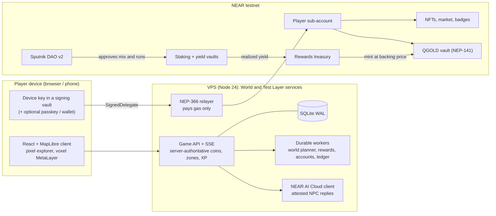

# QuestLayer

**Little adventures. Real discoveries.** QuestLayer is a game platform on NEAR for walk-and-discover games on the
real map. Players start with a name only. Behind the scenes each player gets their own NEAR account, the rewards
and items settle on chain, and the gas is sponsored, so there are no wallet popups, seed phrases or gas prompts.
The chain lives in Settings and on the public treasury page, not in the game.

The economy is **stake-to-play without loss**: NEAR goes into staking and yield vaults, the principal can always
be withdrawn, and only the *realized yield* flows into the treasury and is paid out as daily rewards in **QGOLD**,
the game's name for a share of that treasury. More players never print more money.

Built for the [NEAR Hackathon](https://nearhackathon.com/) (1–14 November 2026), tracks **Games With Real
Economies**, **Social Money** and **Open Innovation**. Everything runs on NEAR **testnet**; nothing here has
monetary value yet.

## Try it now (no install, no wallet)

| Link | What opens |
| --- | --- |
| **https://questlayer.promptstudio3000.com/** | The main address. Until launch it opens the **Test Layer** demo in Plzeň. |
| https://questlayer-test.promptstudio3000.com/ | The Test Layer directly. |
| https://questlayer-test.promptstudio3000.com/?newyork | The same demo in another city: try `?praha`, `?london`, `?tokyo`, `?city=Buenos Aires`. |
| https://questlayer.promptstudio3000.com/?world=1 | **GotchiGO**, the real GPS game (World). Play moves only with a phone's GPS. |
| https://questlayer.promptstudio3000.com/treasury | The public treasury: what is staked, the yield, who decides. |
| https://questlayer.promptstudio3000.com/api/health | Live status: network, build, enabled features, relayer, contracts. |

### Three minutes in the Test Layer

1. Type a name and press **Start**. Pip, the guide, offers a short tour; follow it or skip it.
2. On desktop move with the **demo pad** (arrows or WASD); on a phone walk with GPS or use the pad.
3. Walk over **coins** on the paths. They disappear for every player and pay XP; the Test Layer gives a one-time
   welcome of Test QGOLD after the first coin.
4. Open a **zone**: beat the guardian (a riddle, rhythm or duel), open the chest, receive an **Aura**, wear it and
   **secure** it. Securing mints the NFT to your own NEAR account in the background.
5. Talk to an **NPC** (Talk, Tasks, Profile). NPC conversations run on **NEAR AI Cloud** with signed, attested replies.
6. Open a **creator quest** (the big pins with a photo): Go, then rate and discuss it.
7. **Stake** from the profile, then see the money on **/treasury**. Settings → Account and devices shows the NEAR
   account, the on-chain feed and the 12-word export.

A longer judge guide with "do X, see Y" steps and terminal checks is [docs/JUDGE-WALKTHROUGH.md](docs/JUDGE-WALKTHROUGH.md).

## The layers

QuestLayer is the platform; each layer is a game on it with the same code, the same account and its own contracts.

| Layer | What it is | Where |
| --- | --- | --- |
| **Test Layer** | The demo in Plzeň (or any city via `?cityname`): compact zones, demo bots and seed quests, Pip's tour. Test QGOLD is its own testnet token with no backing. Every new feature lands here first. | `questlayer-test.promptstudio3000.com`, [docs/TEST-LAYER.md](docs/TEST-LAYER.md) |
| **GotchiGO** | The real-world GPS game: Aavegotchi lore on the real map. Coins on mapped paths, quests at real public places, NPCs and monsters at named places across Czechia, Slovakia and Austria, plus demo cities worldwide. Real QGOLD backed by yield. | `questlayer.promptstudio3000.com/?world=1` |
| **MetaLayer** | A shared voxel world: mine, build, follow Keeper Nera's story "The Quiet Beacon". Its coin is MetaGold, with its own testnet contract. | World picker (logo, top left), [docs/LAYER.md](docs/LAYER.md) |

The map uses several hundred thousand safety-filtered public places from OpenStreetMap, Wikidata and GeoNames (no schools,
military or private ground). Live numbers: `/api/health` → `poiWorld` and `autoCities`.

## How NEAR is used

- **Invisible accounts.** A name creates a sponsored sub-account `<name>.play-20261101.questlayer-dev-20261101.testnet`.
  The key is held only by the player's device (with a separate signing-vault origin); a NEP-366 relayer pays gas
  and refuses to move money. [docs/RELAYER.md](docs/RELAYER.md)
- **Yield-funded QGOLD.** QGOLD is a NEP-141 token that is also its own vault: every QGOLD is a share of the NEAR
  that backs it, minted only with that NEAR in the same call. Map coins and zone days are paid only from yield
  that was actually realized: half to coins, half to zones. [docs/QGOLD-VAULT.md](docs/QGOLD-VAULT.md),
  [docs/ECONOMY-RULES.md](docs/ECONOMY-RULES.md), [docs/YIELD-VAULT.md](docs/YIELD-VAULT.md)
- **Stake to play, never lose.** Tier 2 and Tier 3 places open with a one-time stake that can only be withdrawn,
  never spent. About 153 testnet NEAR are staked with validators through keyless vaults today
  (`/api/treasury/mix`).
- **Social money.** The treasury is governed by a stock **Sputnik DAO v2** (`questlayer-treasury.sputnik-v2.testnet`)
  with Trezu's role names: explorers at level 3+ vote weekly on the treasury mix, one explorer one vote, and the
  council approves every run. [docs/TREASURY-DAO.md](docs/TREASURY-DAO.md)
- **NFTs and markets.** Auras and avatars are NEP-171 with royalties; a fixed-price escrow market and a QGOLD escrow
  for player-to-player tasks; badges for visited places.
- **NEAR Social.** Public map notes and quest ratings are written under the player's own namespace.
- **NEAR AI Cloud.** NPC dialogue runs in TDX/confidential-GPU enclaves; each reply's signature is checked.
  [docs/NEAR-AI-CLOUD.md](docs/NEAR-AI-CLOUD.md)
- **Chain ledger.** Each day's game ledger is anchored on chain (`/api/health` → `chainLedger`).

### Contracts on testnet (World / GotchiGO)

Every id below exists on testnet and matches a manifest in `public/*-testnet.json`. The Test Layer has its own set
in `public/*-testlayer.json` (suffix `tl1112`).

| Piece | Account | Source |
| --- | --- | --- |
| Player account factory | [`play-20261101.questlayer-dev-20261101.testnet`](https://testnet.nearblocks.io/address/play-20261101.questlayer-dev-20261101.testnet) | sponsored sub-accounts |
| Gas relayer (NEP-366) | [`relay-20261101.questlayer-dev-20261101.testnet`](https://testnet.nearblocks.io/address/relay-20261101.questlayer-dev-20261101.testnet) | `server/native` |
| QGOLD token + vault | [`questlayer-qgold-vault-20261104.testnet`](https://testnet.nearblocks.io/address/questlayer-qgold-vault-20261104.testnet) | [contracts/qgold](contracts/qgold) |
| Rewards treasury | [`questlayer-rewards-20261101b.testnet`](https://testnet.nearblocks.io/address/questlayer-rewards-20261101b.testnet) | [contracts/rewards](contracts/rewards) |
| Staking vault (validators) | [`stake-20261111.questlayer-dev-20261101.testnet`](https://testnet.nearblocks.io/address/stake-20261111.questlayer-dev-20261101.testnet) | [contracts/vault](contracts/vault) |
| Yield vault (stNEAR, LiNEAR, stablecoins on Rhea) | [`questlayer-yield-20261102.testnet`](https://testnet.nearblocks.io/address/questlayer-yield-20261102.testnet) | [contracts/yield-vault](contracts/yield-vault) |
| Treasury DAO (Sputnik v2) | [`questlayer-treasury.sputnik-v2.testnet`](https://testnet.nearblocks.io/address/questlayer-treasury.sputnik-v2.testnet) | stock Sputnik DAO v2 |
| Game ledger | [`questlayer-ledger-20261104.testnet`](https://testnet.nearblocks.io/address/questlayer-ledger-20261104.testnet) | [contracts/ledger](contracts/ledger) |
| Auras and avatars (NEP-171) | [`nfts.questlayer-dev-20261101.testnet`](https://testnet.nearblocks.io/address/nfts.questlayer-dev-20261101.testnet) | [contracts/collectibles](contracts/collectibles) |
| Aura market (escrow) | [`questlayer-market-20261101b.testnet`](https://testnet.nearblocks.io/address/questlayer-market-20261101b.testnet) | [contracts/market](contracts/market) |
| QGOLD task escrow | [`questlayer-qgold-escrow-20261109.testnet`](https://testnet.nearblocks.io/address/questlayer-qgold-escrow-20261109.testnet) | [contracts/qgold-escrow](contracts/qgold-escrow) |
| Creator money | [`questlayer-creators-20261101b.testnet`](https://testnet.nearblocks.io/address/questlayer-creators-20261101b.testnet) | [contracts/creators](contracts/creators) |
| Place badges | [`questlayer-badges-20261102.testnet`](https://testnet.nearblocks.io/address/questlayer-badges-20261102.testnet) | [contracts/badges](contracts/badges) |
| Item rolls (commit-reveal) | [`questlayer-npc-games-20261101.testnet`](https://testnet.nearblocks.io/address/questlayer-npc-games-20261101.testnet) | [contracts/npc-games](contracts/npc-games) |
| MetaLayer (MetaGold, land) | [`questlayer-metalayer-20261113.testnet`](https://testnet.nearblocks.io/address/questlayer-metalayer-20261113.testnet) | [contracts/metalayer](contracts/metalayer) |
| Public notes and ratings | [`v1.social08.testnet`](https://testnet.nearblocks.io/address/v1.social08.testnet) | NEAR Social (not ours) |

Transaction proofs with hashes (never keys) are in `public/*-proof.json` and the manifests. Details:
[docs/NEAR-INTEGRATION-STATUS.md](docs/NEAR-INTEGRATION-STATUS.md), [docs/CHAIN-PROOF.md](docs/CHAIN-PROOF.md).

### Reproducible contracts

The Rust `near-sdk` workspace in [contracts/](contracts) builds in Docker (`rust:1.97.0`, linux/amd64, path
remapping). CI rebuilds every WASM and fails if a hash differs from [contracts/wasm-sha256.json](contracts/wasm-sha256.json).

```bash
npm run contracts:docker            # rebuild and compare with contracts/wasm-sha256.json
npm run test:contracts              # contract unit tests
```

## Architecture



The player's key signs, the relayer only pays gas, contracts enforce backing and exactly-once claims, and the
server is trusted only for location evidence.

- **Client**: React 19 + TypeScript + Vite, MapLibre on OpenFreeMap vector tiles, Aavegotchi-compatible characters.
- **Server**: Node 24 ESM, SQLite (WAL), durable workers with leases; one codebase, `QL_LAYER=test` switches the
  Test Layer to its own contracts and database.
- **Deploy**: a push to the release branch is tested and deployed by a release runner on the VPS
  ([docs/VPS-RELEASE-RUNNER.md](docs/VPS-RELEASE-RUNNER.md)). [docs/ARCHITECTURE.md](docs/ARCHITECTURE.md) has more.

## Run it locally

Requirements: Node.js 24, npm. No wallet and no keys needed.

```bash
npm ci
npm run dev          # http://127.0.0.1:5173/
npm run check        # build, bundle budget, tests, mainnet guard
```

Locally there is no country import, so outside Plzeň you get plain street cells. The full guide (QA server,
testnet scripts, phone testing) is [docs/HOW-TO-TRY.md](docs/HOW-TO-TRY.md).

## Repository map

```
src/        client (map, dialogs, profile, MetaLayer, wiki)
server/     game API, world planner, NPCs and NEAR AI, native NEAR adapters, relayer, treasury
contracts/  Rust NEAR contracts (reproducible build, wasm-sha256.json)
tests/      node --test suites (fake RPC, isolated SQLite)
public/     assets, testnet manifests and proofs
docs/       rules, economy, layers, operations, audits
deploy/     systemd units and the VPS release runner
```

## Honest state

- Everything is on **testnet**. Mainnet is a later, gated step after phone testing and an external review
  ([docs/MAINNET-PLAN.md](docs/MAINNET-PLAN.md)); until then any claim of "mainnet" is wrong.
- Browser GPS can be spoofed; contracts still enforce backing and exactly-once claims.
- Places away from the reviewed cities come from map data nobody has walked and carry an "Unverified map" notice.
- MetaLayer is a first playable slice; its economy is not switched on yet.

**Timeline.** Every commit in this repository was made inside the hackathon window (first commit 31 October 2026,
after the 19 October announcement). Commit dates are real and were not rewritten. Development runs on
`claude/upbeat-gauss-5czir7` and is merged into `main`.

See [LICENSE](LICENSE) and [THIRD-PARTY-NOTICES.md](THIRD-PARTY-NOTICES.md).
