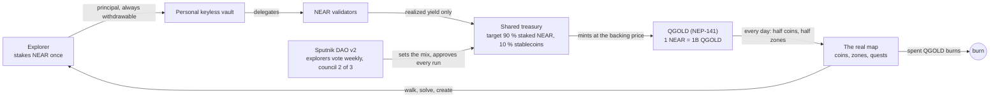
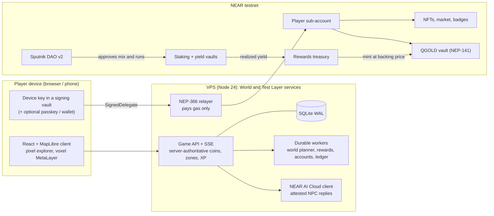

# QuestLayer

**Little adventures. Real discoveries.** QuestLayer is a game platform on NEAR for walk-and-discover games on the
real map. Players start with a name only. Behind the scenes each player gets their own NEAR account, the rewards
and items settle on chain, and the gas is sponsored, so there are no wallet popups, seed phrases or gas prompts.
The chain lives in Settings and on the public treasury page, not in the game.

The economy is **stake-to-play without loss**: NEAR goes into staking and yield vaults, the principal can always
be withdrawn, and only the *realized yield* flows into the treasury and is paid out as daily rewards in **QGOLD**,
the game's name for a share of that treasury. More players never print more money. QGOLD is a scarce in-game
currency backed by real yield, not an income: at today's testnet yield a coin is worth a fraction of a cent, and it
is paid out anyway, in rounds every few minutes, with nothing too small to pay.

Built for the [NEAR Hackathon](https://nearhackathon.com/) (1–14 November 2026), tracks **Games With Real
Economies**, **Social Money**, **NFTs That Do Something** and **Open Innovation**. Everything runs on NEAR
**testnet**; nothing here has monetary value yet.

## Follow the coin (the whole idea in one loop)

**QuestLayer is a real-world GPS game whose prize pool is staking yield.** Players stake NEAR and keep the
principal; only the yield lands on real streets as QGOLD, under a treasury the players govern through a Sputnik DAO.



1. **Play.** Type a name and you are in: no wallet, no seed phrase, no gas. The city is the board and GPS is the
   controller. Coins lie on real paths, zones open every day on real streets, monsters are beaten with riddles,
   rhythm and duels, never with money. Loot is wearable: a secured Aura is an NFT in the player's own account.
2. **Locals.** Characters stand at real places and talk through NEAR AI Cloud; the model writes the words, the
   server decides the rewards. The merchant has his own NEAR account and resells Auras through NEAR Intents.
3. **Creators.** Any explorer can publish a quest on their own street (a trail, a chest, a visit, a story). Others
   play it, rate it and discuss it on NEAR Social. A paid quest settles 80 % to its creator, 20 % to the treasury.
4. **The coin.** A stake sits in the staker's own keyless vault and can only be withdrawn by them. Only the
   realized yield flows into one shared treasury and is scattered over the map as QGOLD, minted only against yield
   that already arrived. Spending QGOLD burns it, so every coin left is backed by more.
5. **The bank.** The treasury follows a stock Sputnik DAO v2. Explorers vote every week on its mix, and a 2-of-3
   council approves each daily run only when it matches the adopted mix.
6. **Layers.** That whole machine is one layer. GotchiGO runs it on real streets, MetaLayer in a voxel world, and
   the next game can plug into the same treasury, the same QGOLD and the same DAO.

## Try it now (no install, no wallet)

| Link | What opens |
| --- | --- |
| **https://questlayer.promptstudio3000.com/** | The main address. Until launch it opens the **Test Layer** demo in Plzeň. |
| https://questlayer-test.promptstudio3000.com/ | The Test Layer directly. |
| https://questlayer-test.promptstudio3000.com/?newyork | The same demo in another city: try `?praha`, `?london`, `?tokyo`, `?city=Buenos Aires`. |
| https://questlayer.promptstudio3000.com/?world=1 | **GotchiGO**, the real GPS game (World). Play moves only with a phone's GPS. |
| https://questlayer.promptstudio3000.com/treasury | The public treasury: what is staked, the yield, who decides. |
| https://questlayer.promptstudio3000.com/api/health | Live status: network, build, enabled features, relayer, contracts. |

### Three minutes in the Test Layer

1. Type a name and press **Start exploring**, then **Let's explore**. Pip, the guide, offers a tour: **Start the
   tour** or **Not now**.
2. On desktop move with the **demo pad** (drag the stick, or arrows / WASD); on a phone walk with GPS or use the pad.
3. Walk over a **coin** on a path: "+2 XP · +250,000 QGOLD". A coin disappears for every player once it is taken, so
   the nearest one can be a short walk away (**Point me there** turns you towards it). The first find also creates
   your NEAR account in the background, and the Test Layer adds a one-time welcome of Test QGOLD.
4. Tap the banner of the **zone** you start in (náměstí Republiky): the sheet lists today's activities. Pick
   **Path chest**, walk to it, press **Open Path chest** and **Open chest**. "Nice find!" shows your **Aura**;
   **Try it on** puts it on your ghost. To make it an NFT open **Inventory → Wardrobe → Advanced** and press
   **Secure this Aura**: the mint to your own NEAR account runs in the background, gas is sponsored, and
   **Check claim** refreshes the card.
5. Walk up to a **monster** on the map and tap it: pick a challenge (riddles, a rune path, rhythm or a duel,
   depending on the day), press **Start challenge** and win with skill. Money never helps.
6. Talk to an **NPC** (Talk, Tasks, Profile). NPC conversations run on **NEAR AI Cloud** with signed, attested replies.
7. Open a **creator quest** (the big pins with a photo, or **Community → Quests**): **Go**, then rate and discuss it.
8. Tap your avatar at the top and open **Stake** to see the tiers and what a stake costs, then open **/treasury**.
   The Test Layer has no treasury of its own: its /treasury page shows GotchiGO's live treasury (one treasury for
   the whole game), and says so. A temporary Test Layer explorer holds only the 0.02 test NEAR for its account, so
   it cannot place a stake; staking is shown with a funded testnet account on GotchiGO. **Settings → Account**
   shows your NEAR account under **NEAR wallet**, with **Open in a wallet** for the 12 words; **Settings →
   Advanced** has the **On-chain feed** with explorer links.

A longer judge guide with "do X, see Y" steps and terminal checks is [docs/JUDGE-WALKTHROUGH.md](docs/JUDGE-WALKTHROUGH.md).

## The layers

QuestLayer is the platform; each layer is a game on it with the same code, the same kind of invisible account and
its own contracts. Each layer keeps its own database, so an explorer made on the Test Layer is not on GotchiGO.

| Layer | What it is | Where |
| --- | --- | --- |
| **Test Layer** | The demo in Plzeň (or any city via `?cityname`): compact zones, demo bots and seed quests, Pip's tour. Test QGOLD is its own testnet token with no backing. Every new feature lands here first. | `questlayer-test.promptstudio3000.com`, [docs/TEST-LAYER.md](docs/TEST-LAYER.md) |
| **GotchiGO** | The real-world GPS game: Aavegotchi lore on the real map. Coins on mapped paths, quests at real public places, NPCs and monsters at named places across Czechia, Slovakia and Austria, plus demo cities worldwide. Real QGOLD backed by yield. | `questlayer.promptstudio3000.com/?world=1` |
| **MetaLayer** | A shared voxel world: mine, build, follow Keeper Nera's story "The Quiet Beacon". Its coin is MetaGold, with its own testnet contract. | World picker (logo, top left), [docs/LAYER.md](docs/LAYER.md) |

The map uses several hundred thousand safety-filtered public places from OpenStreetMap, Wikidata and GeoNames (no schools,
military or private ground). Live numbers: `/api/health` → `poiWorld` and `autoCities`.

## How NEAR is used

- **Invisible accounts.** A name creates a sponsored sub-account `<name>.play-20261101.questlayer-dev-20261101.testnet`.
  The key is held only by the player's device (with a separate signing-vault origin); a NEP-366 relayer pays gas
  and refuses to move money. [docs/RELAYER.md](docs/RELAYER.md)
- **Yield-funded QGOLD.** QGOLD is a NEP-141 token that is also its own vault: every QGOLD is a share of the NEAR
  that backs it, minted only with that NEAR in the same call. Map coins and zone days are paid only from yield
  that was actually realized: half to coins, half to zones. The Test Layer's practice pool is filled by a sponsor,
  so its demo days are subsidised and say so. [docs/QGOLD-VAULT.md](docs/QGOLD-VAULT.md),
  [docs/YIELD-VAULT.md](docs/YIELD-VAULT.md), and the in-game wiki (`/wiki`), which reads its numbers from the code.
- **Stake to play, keep the principal.** Tier 2 and Tier 3 places open with a one-time stake that can only be
  withdrawn, never spent. About 153 testnet NEAR are staked with validators through keyless vaults today
  (`/api/treasury/mix`). Two honest limits of this testnet pilot: each staker gets their own vault contract, and its
  storage costs a one-time **3.52 NEAR that is not returned** when the stake is withdrawn; and the vault factory
  holds at most **32 stakers per layer**. Both are to be redesigned before
  mainnet.
- **Social money.** The treasury is governed by a stock **Sputnik DAO v2** (`questlayer-treasury.sputnik-v2.testnet`)
  with Trezu's role names: explorers at level 3+ vote weekly on the treasury mix, one explorer one vote, and the
  council approves every run. [docs/TREASURY-DAO.md](docs/TREASURY-DAO.md)
- **NFTs and markets.** Auras and avatars are NEP-171 with royalties; a fixed-price escrow market and a QGOLD escrow
  for player-to-player tasks; badges for visited places.
- **NEAR Intents.** Auras trade peer to peer through a self-deployed open-source NEAR Intents verifier (v0.4.5):
  both sides sign, one transaction settles both, 2 % goes to the treasury. The NPC merchant keeps his stock and
  purse in the verifier under his own account. [docs/NEAR-INTENTS-MARKET.md](docs/NEAR-INTENTS-MARKET.md)
- **NEAR Social.** Public map notes and quest ratings are written under the player's own namespace.
- **NEAR AI Cloud.** NPC dialogue runs in TDX/confidential-GPU enclaves; each reply's signature is checked.
  [docs/NEAR-AI-CLOUD.md](docs/NEAR-AI-CLOUD.md)
- **Chain ledger.** Each day's game ledger is anchored on chain (`/api/health` → `chainLedger`).

### Contracts on testnet (World / GotchiGO)

Every id below exists on testnet and matches a manifest in `public/*-testnet.json`. The Test Layer has its own set
in `public/*-testlayer.json` (suffix `tl1112`).

| Piece | Account | Source |
| --- | --- | --- |
| Player account factory | [`play-20261101.questlayer-dev-20261101.testnet`](https://testnet.nearblocks.io/address/play-20261101.questlayer-dev-20261101.testnet) | sponsored sub-accounts |
| Gas relayer (NEP-366) | [`relay-20261101.questlayer-dev-20261101.testnet`](https://testnet.nearblocks.io/address/relay-20261101.questlayer-dev-20261101.testnet) | `server/native` |
| QGOLD token + vault | [`questlayer-qgold-vault-20261104.testnet`](https://testnet.nearblocks.io/address/questlayer-qgold-vault-20261104.testnet) | [contracts/qgold](contracts/qgold) |
| Rewards treasury | [`questlayer-rewards-20261101b.testnet`](https://testnet.nearblocks.io/address/questlayer-rewards-20261101b.testnet) | [contracts/rewards](contracts/rewards) |
| Staking vault (validators) | [`stake-20261111.questlayer-dev-20261101.testnet`](https://testnet.nearblocks.io/address/stake-20261111.questlayer-dev-20261101.testnet) | [contracts/vault](contracts/vault) |
| Yield vault (stNEAR, LiNEAR, stablecoins on Rhea) | [`questlayer-yield-20261102.testnet`](https://testnet.nearblocks.io/address/questlayer-yield-20261102.testnet) | [contracts/yield-vault](contracts/yield-vault) |
| Treasury DAO (Sputnik v2) | [`questlayer-treasury.sputnik-v2.testnet`](https://testnet.nearblocks.io/address/questlayer-treasury.sputnik-v2.testnet) | stock Sputnik DAO v2 |
| Game ledger | [`questlayer-ledger-20261104.testnet`](https://testnet.nearblocks.io/address/questlayer-ledger-20261104.testnet) | [contracts/ledger](contracts/ledger) |
| Auras and avatars (NEP-171) | [`nfts.questlayer-dev-20261101.testnet`](https://testnet.nearblocks.io/address/nfts.questlayer-dev-20261101.testnet) | [contracts/collectibles](contracts/collectibles) |
| Aura market (escrow) | [`questlayer-market-20261101b.testnet`](https://testnet.nearblocks.io/address/questlayer-market-20261101b.testnet) | [contracts/market](contracts/market) |
| QGOLD task escrow | [`questlayer-qgold-escrow-20261109.testnet`](https://testnet.nearblocks.io/address/questlayer-qgold-escrow-20261109.testnet) | [contracts/qgold-escrow](contracts/qgold-escrow) |
| Creator money | [`questlayer-creators-20261101b.testnet`](https://testnet.nearblocks.io/address/questlayer-creators-20261101b.testnet) | [contracts/creators](contracts/creators) |
| Place badges | [`questlayer-badges-20261102.testnet`](https://testnet.nearblocks.io/address/questlayer-badges-20261102.testnet) | [contracts/badges](contracts/badges) |
| Item rolls (commit-reveal) | [`questlayer-npc-games-20261101.testnet`](https://testnet.nearblocks.io/address/questlayer-npc-games-20261101.testnet) | [contracts/npc-games](contracts/npc-games) |
| MetaLayer (MetaGold, land) | [`questlayer-metalayer-20261113.testnet`](https://testnet.nearblocks.io/address/questlayer-metalayer-20261113.testnet) | [contracts/metalayer](contracts/metalayer) |
| Public notes and ratings | [`v1.social08.testnet`](https://testnet.nearblocks.io/address/v1.social08.testnet) | NEAR Social (not ours) |

Transaction proofs with hashes (never keys) are in `public/*-proof.json` and the manifests. Details:
[docs/CHAIN-PROOF.md](docs/CHAIN-PROOF.md).

### Reproducible contracts

The Rust `near-sdk` workspace in [contracts/](contracts) builds in Docker (`rust:1.97.0`, linux/amd64, path
remapping). CI rebuilds every WASM and fails if a hash differs from [contracts/wasm-sha256.json](contracts/wasm-sha256.json).

```bash
npm run contracts:docker            # rebuild and compare with contracts/wasm-sha256.json
npm run test:contracts              # contract unit tests
```

## Architecture



The player's key signs, the relayer only pays gas, contracts enforce backing and exactly-once claims, and the
server is trusted only for location evidence.

- **Client**: React 19 + TypeScript + Vite, MapLibre on OpenFreeMap vector tiles, Aavegotchi-compatible characters.
- **Server**: Node 24 ESM, SQLite (WAL), durable workers with leases; one codebase, `QL_LAYER=test` switches the
  Test Layer to its own contracts and database.
- **Deploy**: a push to the release branch is tested and deployed by a release runner on the VPS
  ([docs/VPS-RELEASE-RUNNER.md](docs/VPS-RELEASE-RUNNER.md)). [docs/ARCHITECTURE.md](docs/ARCHITECTURE.md) has more.

## Run it locally

Requirements: Node.js 24, npm. No wallet and no keys needed.

```bash
npm ci
npm run dev          # http://127.0.0.1:5173/
npm run check        # build, bundle budget, tests, mainnet guard
```

Locally there is no country import, so outside Plzeň you get plain street cells. The full guide (QA server,
testnet scripts, phone testing) is [docs/HOW-TO-TRY.md](docs/HOW-TO-TRY.md).

## Repository map

```
src/        client (map, dialogs, profile, MetaLayer, wiki)
server/     game API, world planner, NPCs and NEAR AI, native NEAR adapters, relayer, treasury
contracts/  Rust NEAR contracts (reproducible build, wasm-sha256.json)
tests/      node --test suites (fake RPC, isolated SQLite)
public/     assets, testnet manifests and proofs
docs/       rules, economy, layers, operations, audits
deploy/     systemd units and the VPS release runner
```

## How it was built: AI and libraries

- **AI-generated code.** Nearly all code, tests and documents in this repository were written with AI coding
  agents (Anthropic Claude Code for the game, server, contracts and operations; OpenAI Codex for the MetaLayer
  voxel world and reviews), directed, reviewed and tested by the author, who made the game design, economy and
  release decisions. The working rules those agents follow are in [AGENTS.md](AGENTS.md).
- **AI at runtime.** On the live layers NPC dialogue runs on NEAR AI Cloud models; the code also keeps optional
  Anthropic and Ollama providers and plain template lines as fallbacks. Rewards, prices and outcomes are always
  decided by server rules and contracts, never by a model.
- **Client libraries.** React 19, TypeScript, Vite, MapLibre GL JS (OpenFreeMap vector tiles), three.js with
  glTF-Transform (characters and the voxel world), Phosphor Icons, Turf, h3-js, tz-lookup.
- **NEAR and crypto libraries.** near-api-js, NEAR Connect (`@hot-labs/near-connect`), borsh, noble curves, hashes
  and ciphers, `@scure/bip39`, SimpleWebAuthn (passkeys), viem (reads Aavegotchi appearances on Base).
- **Server.** Node.js 24 with built-in SQLite and `node --test`, sharp for images, `@anthropic-ai/sdk` for the
  optional provider; no web framework.
- **Contracts.** Rust with `near-sdk` and `near-contract-standards`; stock Sputnik DAO v2 for governance and the
  open-source NEAR Intents (defuse) verifier v0.4.5, both deployed unmodified.
- **Data and art.** OpenStreetMap, Overture Maps, Wikidata and GeoNames for places; Aavegotchi characters and
  Gotchiverse models under the terms in [THIRD-PARTY-NOTICES.md](THIRD-PARTY-NOTICES.md), which lists every
  source and licence.

## Honest state

- Everything is on **testnet**. Mainnet is a later, gated step after phone testing and an external review
  ([docs/MAINNET-PLAN.md](docs/MAINNET-PLAN.md)); until then any claim of "mainnet" is wrong.
- Browser GPS can be spoofed; contracts still enforce backing and exactly-once claims.
- Places away from the reviewed cities come from map data nobody has walked and carry an "Unverified map" notice.
- MetaLayer is a first playable slice; its economy is not switched on yet.
- Staking: the 3.52 NEAR vault setup is not refundable and there is a cap of 32 stakers per layer (see above).
- Older dated documents in `docs/` (for example `ECONOMY-RULES.md`, `STATUS.md`) are kept as history and carry a
  note on top; the README and the in-game wiki are current.

**Timeline.** Every commit in this repository was made inside the hackathon window (first commit 31 October 2026,
after the 19 October announcement). Commit dates are real and were not rewritten. Development runs on
`claude/upbeat-gauss-5czir7` and is merged into `main`.

See [LICENSE](LICENSE) and [THIRD-PARTY-NOTICES.md](THIRD-PARTY-NOTICES.md).
