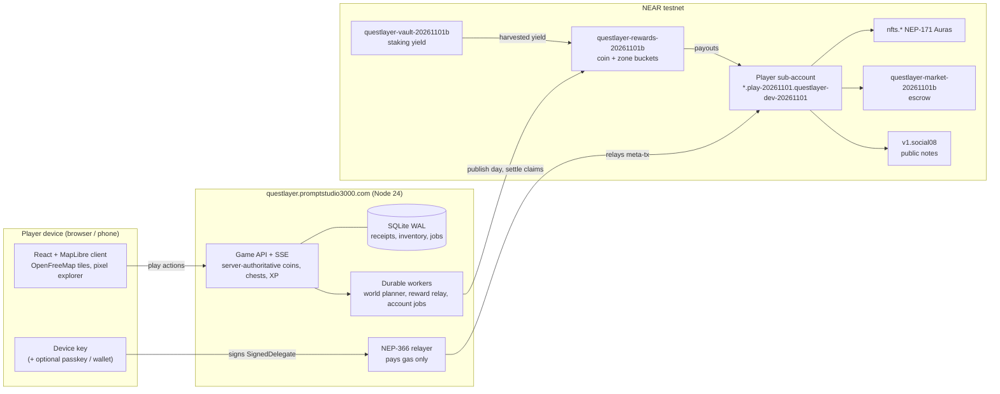

# QuestLayer

**Little adventures. Real discoveries.** A location-based exploration game on real OpenStreetMap geography,
built on NEAR. Open it anywhere in Czechia and there is something to do nearby: street coins on mapped paths, quests
at real public places, NPCs and monsters. In Plzeň, the funded showcase city, open a zone chest, receive an Aura and
wear it on your character. The NEAR account, the rewards and the Aura NFTs exist, but the player never sees a wallet popup,
a seed phrase or a gas prompt: the chain is a property of the items, not a screen.

Built for the [NEAR Hackathon](https://nearhackathon.com/) (1–14 November 2026), tracks **Games With Real
Economies** and **Open Innovation**. Everything runs on NEAR **testnet**; nothing here has monetary value.

**Timeline, stated per the rules.** The hackathon window runs from the announcement on 19 October 2026 to
14 November 2026 (HACKATHON.md, Q-001). Every commit in this repository was made inside that window: the first
commit is dated 31 October 2026 and the alpha, the testnet pilots and all later work were built in the window. There
is no pre-hackathon baseline to separate (Q-003); development continues on the branch `claude/upbeat-gauss-5czir7`
and merges into `main`. Commit dates are real and were not rewritten.

## For judges: 60 seconds, no install

Open **https://questlayer.promptstudio3000.com/** on a phone or desktop. No wallet, no extension, no seed phrase.

| # | Do | See |
| --- | --- | --- |
| 1 | Type a name under "What should we call you?", press **Start exploring** | The Plzeň map with your ghost explorer in the city centre and the chip "City demo · arrows or WASD". On desktop you move with the **Demo walk** pad (hold ↑ or W to run, ←/→ to turn, Shift walks); real play moves only with a phone's GPS. |
| 2 | Walk over a gold coin on a path | The coin disappears for every player, the counter ticks and you get XP. |
| 3 | Press the **Nearest discovery** card, then **Turn toward it** and walk there, then **Open chest** (beat the guardian first if one guards it) | The result sheet: exact XP and the Aura you received ("Reward collected"). |
| 4 | Press **Try it on** | The same Aura is now worn by your character on the map. |
| 5 | Press **Secure this Aura**, then **Share your Aura** | The Aura is minted as an NFT to your own NEAR account in the background (no popup, gas is sponsored); sharing opens the share sheet with a PNG card (downloads on desktop). |
| 6 | Reload the page | Name, XP, Aura and equipment are still there. |
| 7 | Profile → **Advanced** | Your NEAR account id and the network. This is the only place the chain is named. |

### Anywhere in Czechia

On a phone anywhere in Czechia, **Use GPS** (top bar) switches from the Plzeň city demo to your own surroundings.
On desktop, set a location first (Chromium DevTools → Sensors → Location, e.g. Brno 49.1952, 16.6080).

| Where you are | What you get |
| --- | --- |
| Any street cell (H3 res-7, about 5 km²) | Street coins on mapped paths, the generic NPC and monster cast, and up to six **place quests** a day at real public places (single visits and three-stop category hunts, one cell chest). "Nothing here yet" if the cell has no safe place. |
| A town with at least 15,000 people | An **auto city**: daily zones built from map data with an **Unverified map** notice, plus the same place quests per cell. Never funded. Live when `/api/health` → `autoCities.status` is `on`; on 3 November the first build on the public host was still pending, so towns played as street cells. |
| Plzeň (reviewed city) | The six daily zones with chests and the funded reward days. |

The places come from one import of OpenStreetMap, Wikidata and GeoNames for Czechia, filtered for safety (no
schools, military, private ground, places without a public path) before any quest is placed. Live numbers on
[`/api/health`](https://questlayer.promptstudio3000.com/api/health) → `poiWorld` (3 November 2026: 290,817 places,
197,999 quest-ready, place quests possible in 14,999 of the country's ~15,282 cells, 98 %). Away from Plzeň
everything pays XP and cosmetics only, never GOLD or NEAR. Details: [docs/POI-PIPELINE.md](docs/POI-PIPELINE.md),
[docs/POI-SAFETY.md](docs/POI-SAFETY.md), [docs/WORLD-COVERAGE.md](docs/WORLD-COVERAGE.md).

## What is on chain, and where to see it

Every account below is on NEAR **testnet**, existed on 3 November 2026 (checked with `view_account` against
`rpc.testnet.near.org`) and matches the manifests in `public/native-*-testnet.json` and
`public/testnet-deployment.json`. Click an id to open it on NearBlocks.

The first-alpha game contract (`game.questlayer-dev-20261101.testnet`, source [contracts/game](contracts/game):
coin batches, quests, `withdraw_reward`) was retired on 10 November 2026. The live game never called it; its account is
being paused and deleted, so it is no longer linked. Its 1 November deployment transactions stay recorded in
`public/testnet-deployment.json` as history.

| Piece | Account (explorer link) | What to look for |
| --- | --- | --- |
| Player account factory (parent of every explorer) | [`play-20261101.questlayer-dev-20261101.testnet`](https://testnet.nearblocks.io/address/play-20261101.questlayer-dev-20261101.testnet) | Your explorer is `<name-slug>.play-20261101.questlayer-dev-20261101.testnet`, shown in Profile → Advanced. Created after step 1, key held only by your device ([docs/RELAYER.md](docs/RELAYER.md)). |
| Auras and avatars, NEP-171 ([contracts/collectibles](contracts/collectibles)) | [`nfts.questlayer-dev-20261101.testnet`](https://testnet.nearblocks.io/address/nfts.questlayer-dev-20261101.testnet) | The mint from step 5 to your account, and equip calls. |
| Gas sponsor, NEP-366 relayer | [`relay-20261101.questlayer-dev-20261101.testnet`](https://testnet.nearblocks.io/address/relay-20261101.questlayer-dev-20261101.testnet) | Meta-transactions relayed for players. It never carries money. |
| Rewards treasury: coins, zone prizes, XP ([contracts/rewards](contracts/rewards)) | [`questlayer-rewards-20261101b.testnet`](https://testnet.nearblocks.io/address/questlayer-rewards-20261101b.testnet) | Published days and claims. Live books check: `/api/native/distribution` returns `status: verified`. |
| Vault factory ([contracts/vault-factory](contracts/vault-factory)) | [`questlayer-vaults-20261101b.testnet`](https://testnet.nearblocks.io/address/questlayer-vaults-20261101b.testnet) | Created the staking vault below. |
| Staking vault that funds rewards from yield ([contracts/vault](contracts/vault)) | [`questlayer-vault-20261101b.testnet`](https://testnet.nearblocks.io/address/questlayer-vault-20261101b.testnet) | Harvests into the treasury; timeline in `public/native-yield-cycle.json`. |
| Aura market, fixed-price escrow ([contracts/market](contracts/market)) | [`questlayer-market-20261101b.testnet`](https://testnet.nearblocks.io/address/questlayer-market-20261101b.testnet) | Profile → Market: list, buy, cancel. |
| Creator money: paid quests, donations ([contracts/creators](contracts/creators)) | [`questlayer-creators-20261101b.testnet`](https://testnet.nearblocks.io/address/questlayer-creators-20261101b.testnet) | Pilot, enabled on the public host. |
| Sponsored tasks escrow ([contracts/tasks](contracts/tasks)) | [`questlayer-tasks-20261031.testnet`](https://testnet.nearblocks.io/address/questlayer-tasks-20261031.testnet) | Pilot, earlier generation. |
| Public map notes (NEAR Social, not ours) | [`v1.social08.testnet`](https://testnet.nearblocks.io/address/v1.social08.testnet) | Notes written under the player's own namespace. |
| Yield vault: stNEAR, LiNEAR, USDC, USDT deposits ([contracts/yield-vault](contracts/yield-vault)) | [`questlayer-yield-20261102.testnet`](https://testnet.nearblocks.io/address/questlayer-yield-20261102.testnet) | A deposit makes the player a Staker at once; yield is skimmed for map rewards ([docs/YIELD-VAULT.md](docs/YIELD-VAULT.md)). Treasury stNEAR record: `public/stnear-treasury-testnet.json`. |
| Player badges, place badges ([contracts/badges](contracts/badges)) | [`questlayer-badges-20261102.testnet`](https://testnet.nearblocks.io/address/questlayer-badges-20261102.testnet) | Badges minted for visited places ([docs/BADGES.md](docs/BADGES.md)). |
| Item games, commit-reveal rolls ([contracts/npc-games](contracts/npc-games)) | [`questlayer-npc-games-20261101.testnet`](https://testnet.nearblocks.io/address/questlayer-npc-games-20261101.testnet) | Earned roll tickets, `start_roll` / `resolve_roll` ([docs/NPC-GAMES.md](docs/NPC-GAMES.md)). |
| NPC trader Vojtěch (plain account) | [`npc-kupec-vojtech.questlayer-dev-20261101.testnet`](https://testnet.nearblocks.io/address/npc-kupec-vojtech.questlayer-dev-20261101.testnet) | Signed market orders from the trader's own funded account ([docs/NPC-TRADERS.md](docs/NPC-TRADERS.md)). |
| Operator (deploys and owns the dev contracts) | [`questlayer-dev-20261101.testnet`](https://testnet.nearblocks.io/address/questlayer-dev-20261101.testnet) | Plain account, no contract code. |

[`GET /api/health`](https://questlayer.promptstudio3000.com/api/health) shows `"network":"testnet"`, the enabled features
(collectibles, market, rewards, vaults, relayer, social, creators, tasks), the relayer account, the creator-money
contract and `distribution.status: verified`. The 3-minute demo script is [docs/HACKATHON-DEMO.md](docs/HACKATHON-DEMO.md); the longer guided tour for judges, with terminal checks of the economy, is [docs/JUDGE-WALKTHROUGH.md](docs/JUDGE-WALKTHROUGH.md). Transaction proofs with hashes (no keys) are in `public/`; some were recorded on earlier testnet
generations (`questlayer-dev-20261031`, `auratrail-dev-20261030`), so their account names differ from the table:

- `native-invisible-account-proof.json`: name → sponsored sub-account → relayed avatar mint, no wallet.
- `earned-aura-testnet.json`: a chest Aura earned in play and secured to the player's own account.
- `native-distribution-proof.json`: the treasury audit behind "Books checked".
- `native-creators-proof.json`: paid quest access 80/20, donation, support round, creator withdrawal.
- `native-public-record-proof.json`: a public map note under the player's own NEAR Social namespace.
- `native-sponsored-stake-proof.json`: the stake is paid by the player's key; the relayer refuses money.
- `native-rewards-testnet.json`, `native-market-testnet.json`, `native-claims-testnet.json`: contract manifests
  with code hashes.

## Testnet now, mainnet honestly

Everything runs on **testnet** today and nothing here has monetary value. In GPS play every map coin carries backed
testnet QGOLD from the daily budget; the city demo earns XP only ([docs/MAP-REWARDS.md](docs/MAP-REWARDS.md)). Mainnet is a
deliberate, gated step: [docs/MAINNET-PLAN.md](docs/MAINNET-PLAN.md) defines a minimal slice (collectibles,
sponsored accounts and gas with daily caps, NEAR Social) behind `NEAR_NETWORK=mainnet` and `MAINNET_FEATURES`,
with a go/no-go gate on 9 November 2026. The rewards treasury, vaults, market and creator money stay on testnet
until they have an external review. If mainnet ships, this section will name the accounts; until then, any claim
of "mainnet" elsewhere is wrong.

## Run it yourself

Requirements: Node.js 24 (`.nvmrc`), npm. No wallet, no keys.

```bash
npm ci
npm run dev        # open http://127.0.0.1:5173/
```

The steps above work the same locally (secure needs a relayer, see [docs/HOW-TO-TRY.md](docs/HOW-TO-TRY.md)).
Automated checks: `npm run check` (build, application tests, mainnet-guard tests) and
`bash scripts/build-contracts.sh --test` (contract tests). The full guide, including the isolated QA server,
the testnet scripts and phone testing, is [docs/HOW-TO-TRY.md](docs/HOW-TO-TRY.md).

The world has three layers: reviewed cities from `server/data/cities.json` (Plzeň is the only one, and the only one
that can be funded), auto cities built on the server by the World worker for every Czech town with at least 15,000
people, and H3 street cells everywhere else. Locally there is no country import, so outside Plzeň you get street
cells; `npm run world:coverage -- --fixture` and `npm run e2e:world` exercise the Czechia layers on a small fixture.
Promoting an auto city to a reviewed one follows [docs/SECOND-CITY-PLAYBOOK.md](docs/SECOND-CITY-PLAYBOOK.md).
Money is global: one treasury and one daily budget, placed on the map by player demand
([docs/GLOBAL-TREASURY.md](docs/GLOBAL-TREASURY.md)).

## The economy, in one page

[docs/ECONOMY-RULES.md](docs/ECONOMY-RULES.md) lists every live number with its source: 1 NEAR = 1,000 GOLD
display units, coins worth 0.01 GOLD backed before publication, a 50/50 split of eligible income into coin and zone
buckets, six daily Plzeň zones with shared prizes that pay once, personal XP once per account, level rewards as
capped Auras. Practice-only numbers (the 120,000 GOLD welcome credit) are marked as such. Unclaimed backing
returns to its bucket; more players never create money.

## Architecture



The player's key signs; the relayer only pays gas; contracts enforce backing and exactly-once claims; the server is
trusted for location evidence only.

- **Client**: React 19 + TypeScript + Vite, MapLibre on OpenFreeMap vector tiles, Aavegotchi-compatible pixel
  character (official template layers, see `public/art/aavegotchi/provenance.json`).
- **Server**: Node 24 ESM, SQLite (WAL), server-authoritative gameplay (coins, quests, receipts, equipment),
  durable background workers (world planner, reward relay, account/relayer jobs) with leases and backoff.
- **Contracts**: Rust `near-sdk` workspace with eleven members (game, collectibles, rewards, vault, vault-factory,
  market, tasks, creators, npc-games, badges, yield-vault); CI checks every WASM hash against
  `contracts/wasm-sha256.json`.
- **World**: one POI file for Czechia (OSM, Wikidata, GeoNames; SQLite, read-only on the VPS) feeds auto cities,
  place quests and NPC homes; quest titles get nightly AI flavour text that is validated and cached, never trusted
  for rules or rewards.
- **Identity**: name-only start, device key + sponsored sub-account, optional passkey, optional external wallet
  (NEP-413 sign-in). The server never holds a player private key or seed.

Design policy: [DESIGN.md](DESIGN.md). Rules: [docs/GAME-RULES.md](docs/GAME-RULES.md). Roadmap and gates:
[ROADMAP.md](ROADMAP.md). Current state and limits: [docs/STATUS.md](docs/STATUS.md). Audits from 1 November:
[UI](docs/UI-AUDIT-2026-11.md), [code](docs/CODE-AUDIT-2026-11.md).

## Repository map

```
src/        client (App.tsx shell, GameMap, Inventory, native panels, player-key/relayed transport)
server/     API, game, world planner, native adapters, relayer, creators (default off)
contracts/  Rust NEAR contracts
tests/      node --test suites (fake RPC, isolated SQLite)
public/     static assets, official art, testnet manifests and proofs
docs/       status, how-to-try, rules, design, audits, operations
output/qa/  evidence per delivery (screenshots, logs)
deploy/, scripts/  systemd units, VPS deployment and migration, testnet scripts
```

## Trust and limitations

Browser GPS can be spoofed; the location validator is trusted for physical evidence, while contracts enforce
backing and exactly-once claims. Testnet operation is not a mainnet audit. A device-held key is the same custody
class as a browser wallet; the passkey-derived recovery key and the external-wallet link are the recovery paths.
Auto cities and place quests come from map data nobody has walked, so they carry an "Unverified map" notice and
never pay money. Real-device field play, a complete staking yield cycle, NEAR Intents and store distribution remain
open.
See [THIRD-PARTY-NOTICES.md](THIRD-PARTY-NOTICES.md). All product text and documentation are English.
