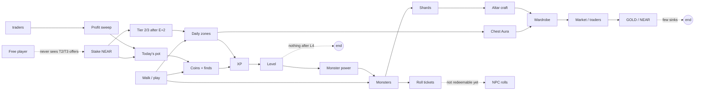

# Game loops: where the fun is, where it leaks, and how staking becomes the goal

1 November 2026. Analysis requested by the owner: research what makes each Aavegotchi ecosystem game fun, check
whether every QuestLayer mechanic sits in a loop that feeds the next one, list what is boring, and design
stakers-only lures so that the main goal (stake NEAR and earn) is something the game pulls players toward.

This is a design document. Nothing here changes code, economics or deployment. Items marked **Decision** need the
owner's go before implementation, because they touch rules in `docs/GAME-RULES.md` (D29, E16, E17) or the economy.

## 1. Summary

- **The loops exist but they end too early.** XP stops paying at level 4 (about 3 days of play), shards have one
  recipe, roll tickets are counted but not redeemable, and GOLD from coins has almost nothing to buy. A player who
  has done the tutorial has no next goal.
- **Staking is invisible from inside the game.** Tier 2/3 content is filtered out (`server/npc/offers.mjs` drops
  quests above the player's tier), so a free player never sees what they are missing. A lure that you cannot see is
  not a lure. Staking itself is a settings screen, and after a deposit nothing happens for two epochs.
- **The Aavegotchi magic is "your money is your pet".** Every Aavegotchi game builds on stake = identity, a daily
  ritual with a cooldown (petting), seasons with a public pot, and holders getting flair rather than power. QuestLayer
  already has the honest version of the economy; it needs those four presentation and loop ideas.
- **Top proposals for the hackathon** (section 7): level bar and level rewards to L10, visible locked staker offers
  at NPCs (tier gate only, owner decision 1 Nov), a "Patron" rank that grows with matured stake age, a daily board of three small
  goals, redeemable roll tickets, a two-week hackathon season, and a "your stake today" card.

## 2. Aavegotchi ecosystem: what each game's magic is

Sources are listed at the end. Several titles are thinly documented; where a game's loop could not be confirmed
it says so rather than guessing.

| Game | Genre | The "magic" | How it achieves it | What QuestLayer takes |
| --- | --- | --- | --- | --- |
| **Aavegotchi (core dapp)** | Staked NFT pet | Your pet *is* your stake. The gotchi holds yield-bearing collateral (its "spirit force"); deposit more and the pet is worth more. | Collateral inside the NFT, kinship that rises with petting every 12 h and falls slowly when ignored, wearables that raise rarity score. | Present the vault position as part of the character, not a bank screen. Kinship-like loyalty that grows with stake age (without the decay penalty, rule D29). |
| **Rarity Farming** | Seasonal meta-game | A public pot you can climb toward. | 8-week seasons voted by the DAO, GHST pot split by Rarity / Kinship / XP (later also Gotchi Battler), leaderboards. | A season with a visible pot and a cosmetic-only leaderboard. Our pot is already real (Today's pot); it needs a season frame. |
| **Gotchiverse** | MMO land / resource world | Passive income you still have to go and collect, and enemies that threaten it. | Daily alchemica *channeling* scaled by kinship, harvesters on parcels, spilled alchemica roaming the map, Lickquidators that attack, guild channeling that rises with every member present. | "Go collect what your stake produced": show which coins in the city your yield seeded today. Co-op bonus when several players hit the boss together. |
| **Gotchi Guardians** | Roguelite tower defense (Steam, browser) | Short runs, a wave you can see coming, mega-bosses, co-op up to 8. | Talent trees per guardian, randomized hazards, purchases that are cosmetic only. Players praised looks, criticized the grind. | Our weekly Lickquidator boss already follows this. Add a visible wave/HP timeline and talent-like unlocks per level, keep cosmetics separate from power. |
| **Gotchi Battler** | Auto-battler, 5v5 | Your NFT's traits become a team role. | Stats mapped from the six on-chain traits; class from the best trait; a preparation window with a consumable shop; tournaments with VRF seeds and a share of the season pot. | A "prep" moment before a monster duel (pick a stance/tactic), and class identity from play style. We never sell power: our power stays level + skill. |
| **Spirit Force Arena** | 3D battle royale | High stakes PvP. | Shrinking forcefield, winner-takes-all matches with up to 100 GHST staked. | Only the shrinking-zone tension (timed zone windows). **Not** the wagering: our rules forbid betting. |
| **Licky's Escape** | Mobile physics puzzle | Bite-sized levels on a phone. | Magnet puzzles, short attempts, collectibles earned while playing. | Monster mini-games should stay under 30 s and be replayable; earned collectibles. |
| **Strategotchi** | Turn-based grid strategy (community) | Small squad, risky mine. | A squad of three gotchis mines alchemica in enemy-infested mines. | The "guarded treasure" idea we already have (guardian-locked chests). |
| **Gotchi Crawler / Dropt** | Roguelike dungeon | Dive deeper or bank what you have. | Rewards grow with depth; meta-progression carries over between runs. | A push-your-luck choice inside a trail quest (continue to a farther, better chest or claim now), no money at risk, only time. |
| **Rektless** | Skill side-scroller | Everyone plays on equal footing. | Holders and non-holders play the same; holders render their own gotchi. | Exactly our rule: NFTs and Auras are identity, not odds. Say it loudly in the UI. |
| **Gotchi Miner** | Classic arcade | One verb, one score. | Mine as many blocks as possible. | Street finds as a one-verb arcade: tap, collect, counter. |
| **DeFi Dungeon** | In alpha | Not documented yet beyond "lower entry barriers, mobile, degen-friendly mechanics". | Could not confirm the loop. | Nothing yet. |
| **Sandbox × Aavegotchi, Gotchi Heroes** | Minigames / unknown | Could not find a gameplay description. | No source. | Nothing. |

### Patterns that repeat across the ecosystem

1. **Stake is identity.** The pet holds the money; more stake shows on the character.
2. **A daily ritual with a cooldown** (petting every 12 h, daily channeling). It brings people back without
   punishing them hard.
3. **Seasons with a public pot** and a leaderboard give a reason to play this week, not just today.
4. **Passive income you collect actively** (channeling, harvesters, spilled alchemica). Money becomes a place on the map.
5. **Shared enemies** (Lickquidators) make the world feel alive and create co-op.
6. **Holders get flair, not power** in the healthier titles (Rektless, Guardians). Where power was sold, players
   complained about grind.

## 3. QuestLayer mechanics today and what each one feeds

| Mechanic | Player does | Gets | Feeds into | Loop status |
| --- | --- | --- | --- | --- |
| Street coins | Walks, collects | 0.01 GOLD, a little XP | GOLD balance | **Leaks**: the GOLD amount is too small to feel and has few sinks. |
| Street finds | Walks to a sparkle | 15 XP | Level; lurkers hide near finds | OK |
| Daily zones (6: 3 Free, 2 Tier 2, 1 Tier 3) | Visit, trail, return trail, chest | XP, Aura from chests, shared GOLD prize (first valid receipt) | Level, wardrobe, GOLD | **Leaks** for free players (they never see what T2/T3 offer). |
| Level (100·(n−1)² XP) | Plays | L2/L3/L4 Auras | Monster power (capped at L20) | **Dead end after L4.** Level 5 needs 1,600 XP and pays nothing. No progress bar in the HUD. |
| Auras (above/below slots) | Equips, trades | Look, set bonus (visual) | Market, trader trade-up, altar craft | OK as identity; no stage to show it off besides the map. |
| Market v2 (signed orders) | Buys / sells Auras | NEAR/GOLD | Wardrobe | OK, but a separate screen with buttons, little traffic without the test seed. |
| NPC talk + quest lines | Talks to a ghost | 1–3 quests, an Aura from the line | Zones, wardrobe | OK; tier-gated lines are **hidden**, not shown as locked. |
| NPC traders | Premium buy, sell, 3→1 trade-up | Better prices, Merchant's Ledger after 10 trades | Market, treasury (sweeps to rewards) | Good loop and it funds the pot. |
| Keeper | Reads stake and vaults | Information only | Nothing | **Dead end**: the bank NPC does nothing a player wants. |
| Monsters (roamer, guardian, lurker) | Quiz / mini-game / stance duel | XP, shards, roll tickets | Guardian unlocks chests; shards to altar | Good, but shards have one recipe. |
| Weekly boss | Hits every 10 min | 60 XP, roll ticket, Bossbane Fangring at 3+ hits | Social, wardrobe | Good; needs a visible schedule so people plan for it. |
| Roll tickets (npc-games) | Earns from lurkers/boss | Commit-reveal roll for an Aura | Wardrobe | Redeemable: Inventory → Secured → Roll at the wisp (docs/NPC-GAMES.md). |
| Altar crafting | 10 shards + common Aura + guardian win | Wardbreaker Horns | Wardrobe | One recipe, then nothing. |
| Staking / Fuel the city | Deposits NEAR, picks 0–100 % contribution | Tier after E+2, retained yield, pot grows | T2/T3 zones, Today's pot | **Weak**: two epochs of silence after deposit, tier benefits are not shown before or after. |
| Today's pot | Looks | Understanding | Motivation | Good idea, needs the player's own share in it. |
| Creator quests | Publishes, locks XP | Followers, completions, creator round | Content supply | Competes with leveling (locked XP lowers level); fine for veterans. |
| Community tasks, map notes | Posts, completes | Escrowed bounty | GOLD | Separate island; does not touch level or stake. |

### The loop map

Dotted arrows are the leaks. The most important missing arrow is **free player → wants to stake**.

## 4. What is boring today (honest list)

1. **Walking between far destinations with nothing in between.** Six zones across the city with real gaps is
   correct (G04), but the walk itself is empty except coins. Lurkers and finds help; they need to be visible
   on the route preview.
2. **Numbers you cannot feel.** 0.01 GOLD per coin, XP without a bar, a level without a next reward.
3. **Text instead of play.** Sheets and info panels are long, NPC talk is paragraphs, economy screens are prose.
   (UI audit 2026-11 finding 11 counted 74 `
` in CreatorCommunity alone.)
4. **No session goal.** After opening the app the player sees a list of places, not "today you can do these three
   things".
5. **The stake does nothing you can see.** Deposit, wait two epochs, a tier label changes. No ceremony, no new
   options, no NPC reacting to you.
6. **Visit quests feel identical.** v2 manifest templates (trail, return trail, chest) help; NPC lines and
   guardians help more because they add a reason.
7. **No week rhythm.** The boss is weekly but its time is not on the map or a calendar; there is no season.
8. **The bank NPC is read-only.** The Keeper is a lore figure with nothing to offer.

## 5. The stake-and-earn funnel

Goal: a player should *want* to stake because of what they see while playing, and should *feel* earning after they
stake. The economy rules stay as they are: prizes come only from received yield or sponsors, Auras are cosmetic,
monster power is level + skill, no wagering.

| Stage | Player sees | What moves them on |
| --- | --- | --- |
| 1. Free explorer (L1–L4) | Free zones, coins, monsters, NPC talk | Locked offers are visible from the start (greyed, with a lock and "Stakers · Tier 2"). |
| 2. Curious (any level) | The Keeper says "the inner vault opens for patrons" and shows the T2 zone prize of today | A small first stake has a clear, previewed result: what unlocks, when (E+2 date), what it earns. |
| 3. New staker (deposit confirmed) | A pending patron badge on the avatar, a countdown to E+2, NPCs greet "future patron" | E+2 ceremony: the badge lights up, locked chips at NPCs turn on, one welcome quest line opens. |
| 4. Patron (Tier 2) | Patron quest lines, patron trader rates, patron-only cosmetics, "your stake today" card | Patron rank grows with matured stake days; Tier 3 preview is visible the same way. |
| 5. High patron (Tier 3) | Tier 3 zone, the rare wanderer's patron option, season leaderboard flair | Season pot and cosmetic ranks keep them in. |

### Stakers-only lures (respecting the rules)

**Owner decision (1 Nov 2026, 23:00 UTC): lures are gated by tier only, with no level requirement.** A player
unlocks them as soon as their stake matures at E+2 into Tier 2 or Tier 3. Every
lure is something to *do* or *wear*, never better odds or a payout multiplier.

| Lure | Where | Gate | Why it fits the rules |
| --- | --- | --- | --- |
| **Locked offer chips** | NpcSheet: storyteller, quest giver, trader, keeper, wandering rare | Shown to everyone; usable at Tier 2 (Tier 3 for the rare) | Pure presentation. Today `offers.mjs` filters these out; it should return them with `locked: {tier}` instead. |
| **Patron quest lines** | Storyteller and quest giver | Tier 2 | Lines lead into T2/T3 zones, which already require the tier (E16). Their prize is still the zone's backed prize. |
| **Keeper's inner vault** | Keeper | Tier 2 | Gives the bank NPC a job: a patron-only story line, the "your stake today" card and the E+2 ceremony. Reads only, never moves funds. |
| **Patron trader rates** | Traders | Tier 2 | Trade-up 3→1 becomes available on a rare→epic table, and the premium-buy budget prefers patrons. The margin floor and sweep stay, so the float still grows (owner decision 1 Nov). |
| **Patron edition Auras** | Keeper line, NPC-only editions | Tier 2, earned by finishing the patron line | NPC-only editions are already approved; cosmetic only (E17). |
| **Patron rank** (kinship-like) | Avatar badge, profile | Grows with each epoch of matured, unwithdrawn stake; ranks 1–5 | Rewards holding, not depositing more. No decay or streak penalty (D29): withdrawing just stops growth; the earned rank cosmetic stays. **Decision** (new progression track). |
| **Wandering rare's patron option** | Wandering rare NPC | Tier 3 | The rare is visible to everyone (FOMO), its extra dialogue and edition only for high patrons. |
| **Boss arena seat** | Weekly boss | Tier 2 | A patron-coloured spot and a name plate on the hunters board. Damage stays level × skill (fairness rule §13.3). |

What we deliberately do **not** offer stakers: extra roll tickets, higher odds, more boss damage, bigger coin values
for the same walk, or anything bought with GOLD that changes a chance. Those would break the fairness and no-wagering
rules and the legal line in NPC-PLAN §7.3.

### Making earning visible

- **"Your stake today" card** (Keeper and Profile → Stake): validator yield retained by you today, the part you gave
  to the city, and *which coins on today's map your contribution backed* (the Gotchiverse channeling idea, honest
  version: attribution only, the coins are still shared and first-come). Data: vault position + treasury allocation
  receipts already exist; the per-coin attribution is a display over the day's allocation, not a new money path.
- **E+2 countdown** with the real epoch, not hours, and a ceremony when it matures.
- **Season pot** (see 7): the sum of yield + trader sweeps + sponsors that funded the season, shown as a meter.

## 6. Connecting the loose ends

| Leak | Fix | Effort |
| --- | --- | --- |
| Nothing after L4 | Level table to L10 with an unlock at every level, not always an item: L5 second craft recipe, L6 extra NPC quest slot, L7 boss name plate colour, L8 third craft recipe, L9 cosmetic title, L10 a level Aura. Items need supply-capped editions. | M |
| No XP bar | HUD avatar with an XP ring and "Level 4 · 620 / 900"; the API already returns `levelStartXp` and `nextLevelXp`. | S |
| Roll tickets dead end | Worker signs `earned:npc-roll:<id>` for resolved and timed-out rolls; ticket count shows a "Roll at the wisp" button. | M |
| One craft recipe | Three more altar recipes using shards + commons (sink for commons, which also restocks traders). | S |
| GOLD has no sinks | Spend GOLD at traders and on creator paid access (already exists); show GOLD as "spendable" next to the item price. Do not add a new currency (D29). | S |
| Keeper read-only | Inner vault line + stake card (section 5). | M |
| Free players never see T2/T3 | Locked chips (section 5). | S |
| No session goal | Daily board: three small goals picked from today's world (collect 10 coins, beat one monster, talk to one NPC). Completing all three gives a small XP bonus. No streak, no penalty. **Decision** (D29 check: a daily board is not energy or a streak). | S–M |
| No week rhythm | Boss schedule chip on the map and in the daily board; tomorrow teaser at session end. | S |
| No season | A two-week "Hackathon season" (until 14 Nov): cosmetic leaderboard by hunts, visits and NPC lines (never money), season Aura for everyone who reaches a goal, the season pot meter. **Decision**. | M |
| Empty walks | Route preview shows lurkers and finds along the way; a push-your-luck "continue the trail" choice (time only). | M |

## 7. Prioritized proposals

P0 should land before the submission (14 Nov), P1 if time allows, P2 after.

| # | Proposal | Why first | Needs owner decision |
| --- | --- | --- | --- |
| P0-1 | XP bar + level table to L10 | Fixes the earliest dead end, everyone sees it | Level item editions (supply) |
| P0-2 | Locked staker chips at NPCs (tier gate) | The cheapest lure; turns hidden content into a reason to stake | Decided: tier only (Tier 2, Tier 3 for the rare) |
| P0-3 | Keeper inner vault + "your stake today" card + E+2 ceremony | Makes earning visible, gives the bank NPC a job | No |
| P0-4 | Redeem roll tickets | Closes a dead end that already has a contract | No |
| P0-5 | Daily board of three goals | Gives every session a target | Yes (D29 check) |
| P1-1 | Patron quest lines + patron edition | The core staker reward | Patron edition supply |
| P1-2 | Patron rank by matured stake age | Kinship-like retention for stakers | Yes (new track) |
| P1-3 | Hackathon season with cosmetic leaderboard and season pot meter | Week rhythm, demo story for judges | Yes |
| P1-4 | More altar recipes | Shard and common-Aura sinks | No |
| P1-5 | Patron trader rates | Better deals without breaking the float rule | Trader parameters |
| P2-1 | Co-op boss bonus when several players hit within the same window (guild channeling idea) | Social play | No |
| P2-2 | Push-your-luck trails, route preview with monsters | Makes walks interesting | No |
| P2-3 | Stance "prep" before duels (Battler-style) | Depth in combat without selling power | No |

### Decisions settled (1 Nov 2026, 23:40 UTC)

The owner switched the project to no-ask mode (only mainnet and secrets in GitHub still need him), so the open
decisions above are settled as follows:

| Topic | Decision |
| --- | --- |
| Staker lure gate | Tier only, no level (owner's own choice, 23:00 UTC): Tier 2; Tier 3 for the wandering rare. |
| Level table L5–L10 | Yes. Unlocks at every level as in section 6; only L10 grants an item (a new supply-capped level Aura edition). |
| Patron rank | Yes. Ranks 1–5 grow with matured, unwithdrawn stake epochs; no decay, the earned rank cosmetic stays after a withdrawal. |
| Daily board | Yes. Three goals from today's world, a small XP bonus for all three, no streak and no penalty, so it is not a D29 streak mechanic. |
| Hackathon season | Yes, until 14 Nov 23:59 UTC. Leaderboard counts hunts, visits and NPC lines, never money; a season Aura for everyone who reaches the goal. |

## 8. UI direction (handed to the UI thread)

The owner's notes (1 Nov) and this analysis agree on the same UI shape. The UI thread owns the implementation.

- **Character screen with the photo first.** Avatar render at the top with both Aura slots, equipped gotchi
  wearables around it as slots, traits/stats beside it, level ring, patron badge and rank.
- **Inventory as a classic grid.** Square cells with item art, rarity frame, count badge, lock icon for
  not-yet-earned items, tap for a compact detail with actions (wear, sell, trade up, craft).
- **Screens with tabs instead of button lists.** Inventory: Items | Wardrobe | Market | Altar. Profile: Character |
  Stake | Receipts | Settings. Community: Nearby | Tasks | Notes | Creators. NPC sheet: Talk | Quests | Trade |
  Patron (locked chip).
- **Short sheets.** Every bottom sheet gets tabs and a max height; prose moves into "Details" disclosures.
- **Service buttons small and together.** One compact toolbar or a gear menu (recenter, 2D/3D, location, help,
  settings) instead of buttons spread across menus.
- **Locked staker chips** use one shared component: greyed art, lock, "Stakers · Tier 2", tap opens the stake
  preview.
- **HUD:** avatar with XP ring, GOLD, daily board progress (0/3), boss countdown when relevant.
- **Seeded content in every tab** (market, inventory, tasks, creators) via the test world (`TEST_SEED=1`,
  `docs/TEST-SEED.md`) so no tab looks empty in the demo.
- **More illustration:** Aavegotchi wearables and Gotchiverse models (rights confirmed for Gotchiverse characters,
  PR #55) for NPC portraits, empty states, the altar, the keeper's vault and the boss arena.

## Sources

- Aavegotchi Game Center list: <https://wiki.aavegotchi.com/games>
- Pixelcraft 2026 plans (Guardians on Steam, Gotchiverse 3D, Rektless, DeFi Dungeon, Gotchi Miner):
  <https://blog.aavegotchi.com/aavegotchi-2026-what-pixelcraft-is-shipping-next>
- Gotchiverse wiki (alchemica, channeling, installations, Lickquidators): <https://wiki.aavegotchi.com/gotchiverse>
- Guild channeling: <https://wiki.aavegotchi.com/guild>
- Rarity farming: <https://docs.aavegotchi.com/own/earning-in-aavegotchi/rarity-farming>
- Gotchi Battler: <https://wiki.aavegotchi.com/gotchi-battler>, <https://blog.aavegotchi.com/100k-ghst-tournaments-are-coming>
- Gotchi Guardians on Steam: <https://store.steampowered.com/app/3818910>, <https://blog.aavegotchi.com/gotchi-guardians-has-launched-on-steam>
- Spirit Force Arena: <https://blog.aavegotchi.com/spirit-force-arena-is-soft-launching-first-on-hyperplay>
- Licky's Escape: <https://whatoplay.com/post/lickys-escape-ios>
- Strategotchi: <https://wiki.aavegotchi.com/strategotchi>
- Gotchi Crawler litepaper (Google Doc linked from the Aavegotchi Game Center announcement):
  <https://egamers.io/aavegotchi-introduces-game-center-on-the-aavegotchi-dapp/>
- Most sources are 2023–2025; the live state of individual games may differ.
